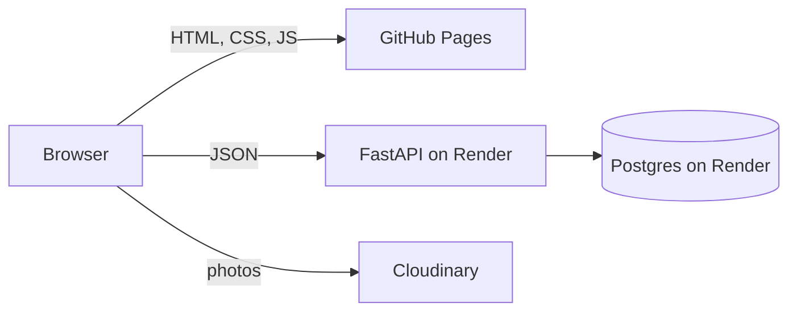

# Andy Price Memorial Archive

A personal photo archive: more than 3,600 photographs from 2008 to the present, browsable as a random mix or as a full list. Less a portfolio, more a lucky dip through the years.

**Live site:** [andyprice.co](https://andyprice.co)

## Features

- **Weighted random selection.** Roll the dice for a fresh set of photos. A slider tilts each selection towards older or newer pictures, and photos you have already seen are excluded until the archive runs out.
- **All Images page.** Every photo, sorted newest or oldest first, with infinite scroll.
- **Masonry layout.** Photos keep their true aspect ratio instead of being cropped.
- **Responsive.** Works on desktop and phones.
- **Resilient.** Failed requests show a short message instead of a blank page, and the API exposes a health check.

## How it works



The database stores only **metadata** for each photo: a content hash, the Cloudinary public ID, the date taken, and the pixel dimensions. The photos themselves live on Cloudinary, which resizes and compresses them on the fly. The browser builds each image URL from the public ID, so no image URLs are stored.

Raw facts are stored and derived values are computed at runtime. For example, each tile's height in the masonry grid is calculated in the browser from the stored width and height.

## Tech stack

| Area | Tools |
| --- | --- |
| Frontend | Plain HTML, CSS and JavaScript (ES modules, no bundler) |
| Backend | Python, FastAPI, psycopg |
| Database | PostgreSQL |
| Images | Cloudinary |
| Image processing | Python, Pillow |
| Hosting | GitHub Pages (frontend), Render (API and database) |
| CI/CD | GitHub Actions deploys the frontend, Render deploys the API |

## Project structure

```
ap-archive/
├── backend/
│   ├── main.py             # FastAPI app: /random, /all-images, /health
│   ├── schema.sql          # The images table
│   └── requirements.txt    # API dependencies
├── frontend/
│   ├── index.html          # Home: weighted random grid
│   ├── all-images.html     # Full archive with sort and infinite scroll
│   ├── about.html
│   ├── js/                 # ES modules
│   └── styles/
├── scripts/                # Image processing, upload and removal tools
├── docs/
│   └── adding-images.md    # How to add new photos
└── .github/workflows/
    └── pages.yml           # Publishes frontend/ to GitHub Pages
```

## API

| Method and path | Parameters | Returns |
| --- | --- | --- |
| `POST /random` | Query: `weight` (0 to 1, default 0.5), `limit` (default 50). Body: `{"ids": [...]}` of photo ids to exclude | `{"photos": [...], "hasMore": bool}` |
| `GET /all-images` | Query: `sort` (`ASC` or `DESC`), `offset` (0 or more), `limit` (default 50) | `{"photos": [...], "hasMore": bool}` |
| `GET /health` | None | `{"status": "ok"}`, or `503` if the database cannot be reached |

Values outside the allowed ranges are rejected with `422`. An unknown `sort` value returns `400`. The queries use placeholders for all user-supplied values, and the sort order is picked from a fixed lookup.

## How the random selection works

Each photo's date is normalised between the oldest and newest photo in the archive (min-max normalisation). The slider value blends that score: towards 1 it favours newer photos, towards 0 older ones. A small floor keeps every photo possible even at the extremes. Selection is then done in SQL with `ORDER BY power(random(), 1 / weight) DESC`, a weighted-random technique, with photos already seen excluded.

## Adding new photos

See [docs/adding-images.md](docs/adding-images.md).

<details>
<summary><strong>Running locally</strong></summary>

&nbsp;

You will need Python 3 and PostgreSQL. The table starts empty, so see [docs/adding-images.md](docs/adding-images.md) to fill it.

```bash
# Database
createdb ap_archive
psql ap_archive -f backend/schema.sql

# API (http://127.0.0.1:8000/docs)
python3 -m venv venv
source venv/bin/activate
pip install -r backend/requirements.txt
cd backend
uvicorn main:app --reload --port 8000

# Frontend, in a second terminal (http://127.0.0.1:3000)
cd frontend
python3 -m http.server 3000 --bind 127.0.0.1
```

Use `127.0.0.1` and not `localhost`. By default the API only allows that origin.

**Environment variables**

| Variable | Used by | Default | Purpose |
| --- | --- | --- | --- |
| `DATABASE_URL` | API | `dbname=ap_archive` | Postgres connection string |
| `ALLOWED_ORIGINS` | API | `http://127.0.0.1:3000` | Comma-separated list of origins allowed by CORS |

The image scripts need a `CLOUDINARY_URL` in a `.env` file, which is gitignored. Never commit credentials.

</details>

<details>
<summary><strong>Deployment</strong></summary>

&nbsp;

- **Frontend:** a GitHub Actions workflow publishes `frontend/` to GitHub Pages whenever a push to `main` changes it.
- **API and database:** a Render web service (built from `backend/`) and a Render Postgres database in the same region. Render deploys when `backend/` changes and uses `/health` to check a new version before switching traffic to it.
- **The two deploys are independent.** A change that touches both needs both to finish before it can be tested live.

</details>

## Photographs

All photographs are © Andy Price. All rights reserved.
